# Robs Opus Quad Mods

**The first custom firmware for the Pioneer OPUS-QUAD.**

Robs Opus Quad Mods is a custom-firmware project for the OPUS-QUAD, based on official firmware **1.32**.

The current public build is **R120 (1.32X)**. It adds a native four-deck waveform layout, CDJ-3000 style side screens, a side-screen browser, stems, and a collection of optional interface, browsing, FX, cue and jog-ring features. The firmware is installed with the **OQ Mods Patcher**, which builds the update from your own official 1.32 file; Pioneer firmware files are not included.

### Mods and the installer

Every feature is a separate **mod** that lives on your settings USB in `MODS/<mod>/`. The firmware is a slim base that loads them; each mod is switched on and configured in **ROBS MOD MENU** on the player, and mods can be added, updated or removed without flashing new firmware.

The **OQ Mods Patcher** (macOS and Windows) handles both:

- **Mods tab** — reads the live mod list from this repository (`mods/`), shows the version on your USB stick next to the latest one, and installs or updates the mods you tick. Older versions can be picked from each mod's version menu, **Changelog** shows what changed in every version, and **?** describes the mod. Mods new to a stick start switched off; your mod settings are kept.
- **Firmware tab** — lists the released firmware versions with their changelogs and shows which firmware your player runs. It downloads the firmware patch and writes the update to your USB stick, made from your official `OPUSQUADv132.UPD` on your own computer.

> **Use this firmware at your own risk.** I have flashed firmware on my OPUS-QUAD many times—well over a hundred—and have always been able to recover from failed attempts by restoring stock firmware. That is my experience, not a guarantee: a failed flash could still leave your unit unusable, and recovery may not work for everyone. Keep a known-good official stock 1.32 update available on a separate USB, use reliable power, and never interrupt an update. Use only with an OPUS-QUAD and the exact official 1.32 update file accepted by the patcher. I have tested restoring stock 1.32 and installing a custom build on a physical unit; this does not guarantee every unit or future build.

### Four-deck waveform view

Four native detailed waveforms in **Deck 3, Deck 1, Deck 2, Deck 4** order (the mixer order), or **1, 2, 3, 4** if you prefer. The optional Beat FX sidebar sits at the right; the original track overviews can be enabled separately.

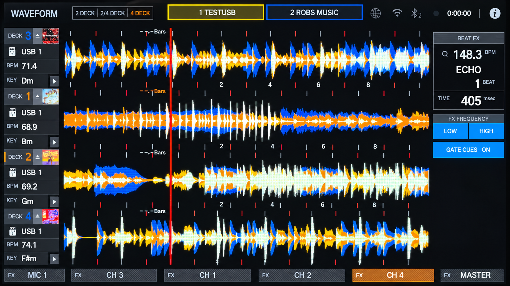

### TYTO's Side Screen View

CDJ-3000 style side screens by **TYTO**: each side display shows the selected deck's scrolling waveform with beat grid, hot cues and memory cues, the cover art, title, key, tempo, BPM and remaining time, plus the master deck's waveform above it. The master deck is marked with an orange **MASTER PLAYER** badge. The view follows Light Mode and Hide Track Name. The previous FLX10-style view is still available as the **Side Screen Waveforms (Legacy)** mod.

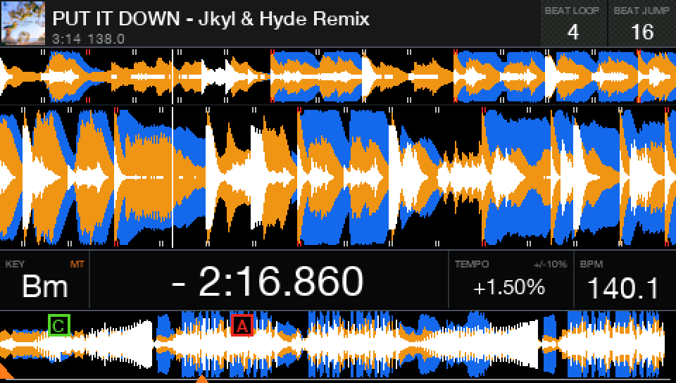

### Browse from the side screens

Hold a deck selector to open that deck's side-screen browser. Browse USB → playlist → track, then confirm to load. Track lists show the title, artist, BPM and key. Navigate with the beat-loop wheels (default), the deck buttons or the track-search buttons.

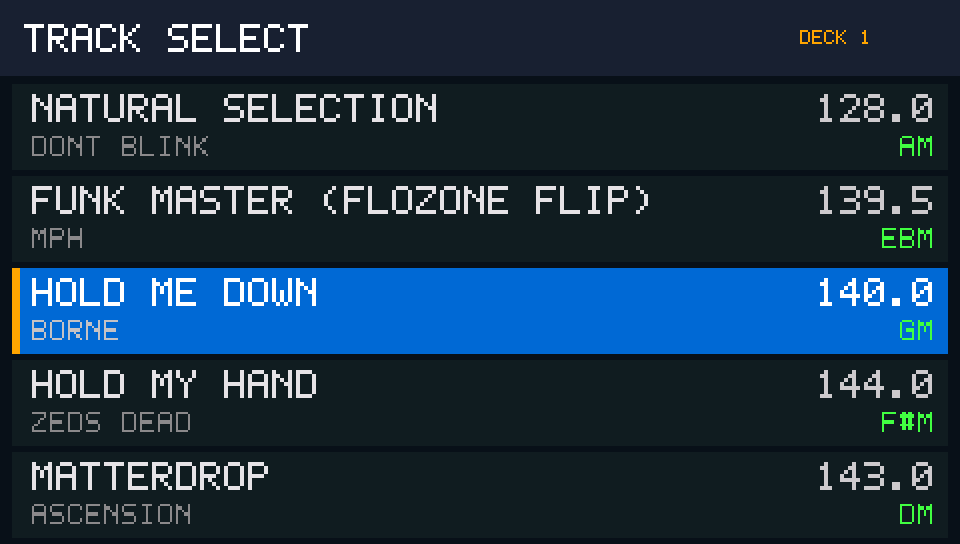

### Stems

Mute VOCAL, INST, BASS and DRUMS per deck in real time from the touch screen. Make the stems on a computer (Demucs or the AZ-MODS app) and put them on the USB as `STEMS/<track file name>/vocals.ogg other.ogg bass.ogg drums.ogg`. Tap **STEMS** at the top of the WAVEFORM screen to open the buttons: a strip under the waveforms in 2 DECK, and above the channel select row in 4 DECK. Tempo, key and scratching still apply. The first load of a track takes a few seconds while its stems are decoded.

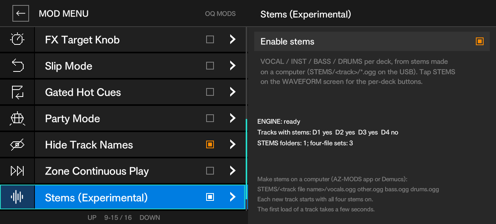

### Light Mode

An alternate, softer interface palette that keeps the four-deck layout and the right-side FX panel, including the mixer and MIC panels and the deck input menu. A blue-waveform palette is available.

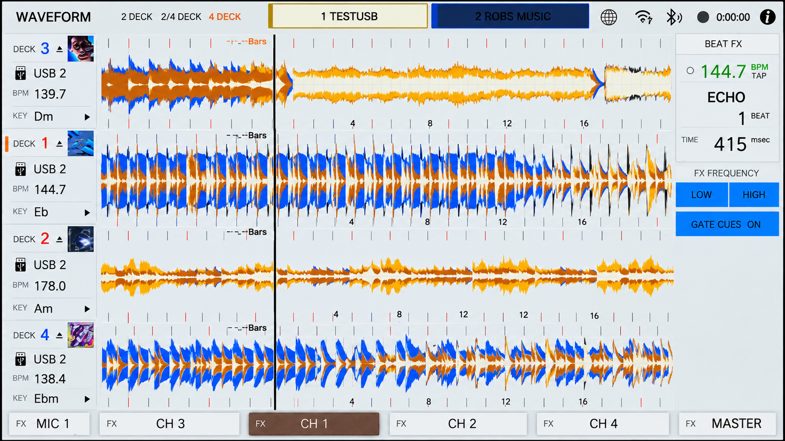

### Gate Cues

On a paused deck, hold a hot cue to audition it; releasing returns to the cue point and stops playback unless PLAY was pressed while the cue was held. A quick toggle is available in the Beat FX sidebar.

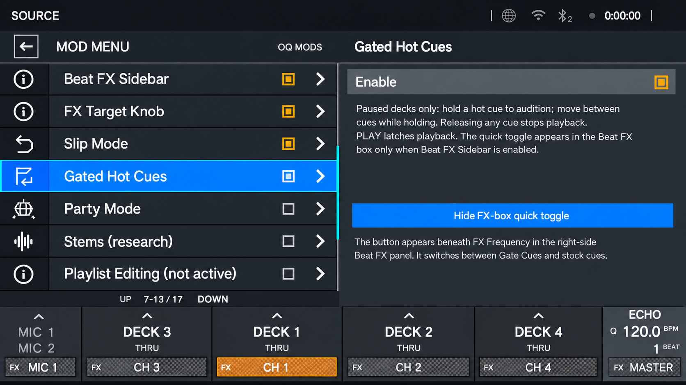

### FX Frequency

**LOW | ALL | HIGH** in the Beat FX box: LOW keeps the effect in the lows, HIGH in the highs, ALL is the stock full range. The choice stays when you switch effects; tap the lit LOW or HIGH again to go back to ALL.

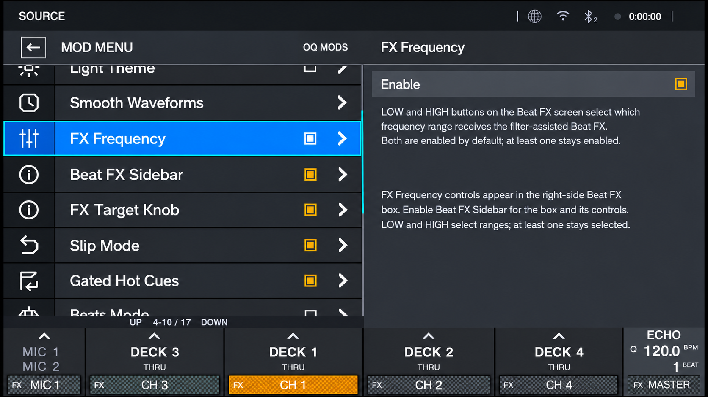

### Slip Mode

Slip Mode is toggled per deck through the SLIP REVERSE control, with LED feedback. When the mod is disabled, the control returns to its stock Slip Reverse behavior.

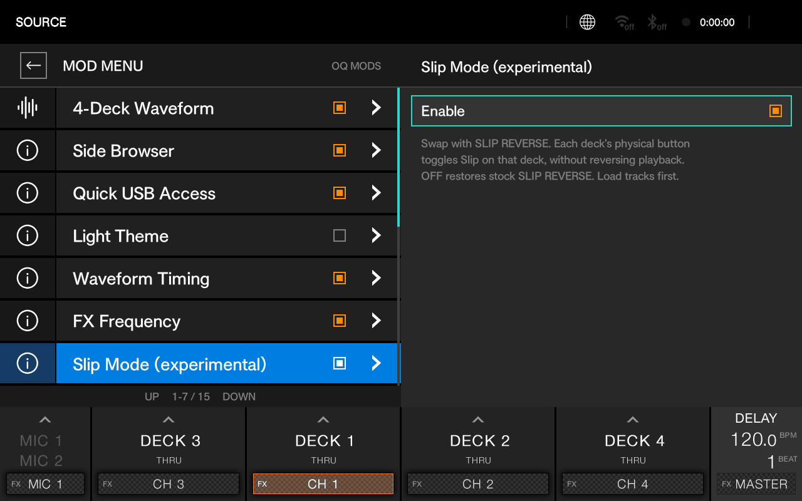

### Quick USB Access

Named, color-aware USB shortcuts near the waveform header; the active USB is highlighted. Selecting one opens that USB's native browser rather than loading a track directly.

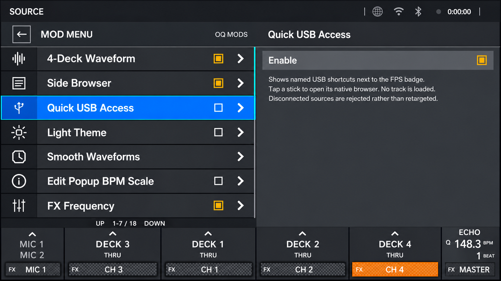

### Continuous Zone Playback

With ZONE output on and assigned to channel 3 or 4, that deck loads and plays the next track of its playlist when a track ends, whatever the global Continue/Single setting. Other decks are unchanged.

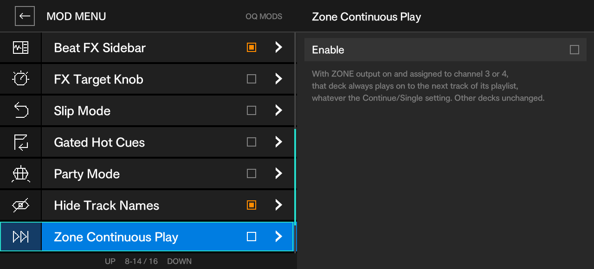

### Party Mode

Optional jog-ring effects—Rainbow, Color Steps, Breathe, Police, Color Flash and Ring Chase—with four speed settings. Slip indicators keep priority, and turning Party Mode off restores native colors. Flashing effects are optional; avoid them if you or anyone nearby is sensitive to flashing lights.

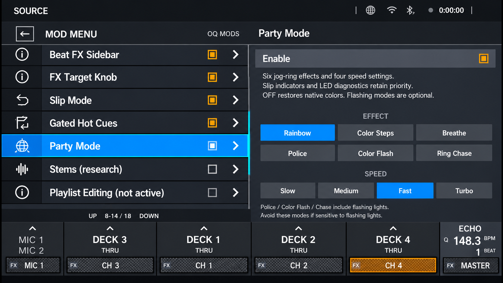

## Included mods

Install them with the OQ Mods Patcher, then switch them on and configure them in **ROBS MOD MENU** (SOURCE > ROBS MOD MENU). Mods start switched off.

- **4-Deck Waveforms** — four full-height native waveform lanes, in mixer order (3 / 1 / 2 / 4) or deck order (1 / 2 / 3 / 4), with smoothing modes (Native Height 30 is the default and recommended) and optional track overviews. The stock 2 DECK and 2/4 DECK layouts remain available.
- **TYTO's Side Screen View** — CDJ-3000 style side screens with the selected and master deck waveforms, cover art and track information.
- **Side Screen Browser** — a deck-specific browser on the side displays. Browse USBs, playlists and tracks (with artist, BPM and key) and confirm to load. Beat-loop wheels by default, with deck-button and track-search-button schemes available. Stock Load Lock is required.
- **Stems** — real-time VOCAL / INST / BASS / DRUMS mutes per deck from pre-made stem files. Based on the AZ-MODS stems engine.
- **Light Mode** — light interface palettes, including a blue-waveform option. Also changes TYTO's side-screen waveforms.
- **Quick USB** — named, color-coded on-screen USB shortcuts that open the selected source in its native browser; the active one is highlighted.
- **Beat FX Sidebar** — the Beat FX panel at the right of the main waveform screen in every layout. It steps aside for the INPUT, crossfader, MIC, FX list and track-info pop-ups.
- **FX Frequency** — LOW | ALL | HIGH for Beat FX, kept across effect changes. Needs Beat FX Sidebar.
- **FX Knob Selector** — turn the Beat FX TIME knob to step through MIC, Deck 3, Deck 1, Deck 2, Deck 4 and MASTER, with one to five detents per target (three by default). Hold SHIFT while turning TIME for normal effect-time adjustment.
- **Gate Cues** — on a paused deck, hold a hot cue to audition it; release returns to the cue point unless PLAY was pressed while holding. Quick toggle in the FX sidebar.
- **Slip Mode** — the Slip Reverse control toggles Slip per deck, with LED feedback.
- **Playlist Editing** — reorder the tracks of a USB playlist in main Browse: hold the browse knob on a track, turn to move it, press to drop, then BACK to save. This writes the USB library; the first save each boot backs up `exportLibrary.db` and `export.pdb` to `OPUSMOD_BACKUP` on that USB. Use it with a USB you have a copy of.
- **Party Mode** — jog-ring effects and speed settings described above.
- **Hide Track Name** — an eye on each track box hides that deck's title and artist on the main screen and on the side screens, including TYTO's. Tap it again to show them.
- **Continuous Zone Playback** — the zone deck (channel 3 or 4) plays on through its playlist.
- **Side Screen Waveforms (Legacy)** — the original FLX10-style side-screen view: waveform, cues, loops, BPM, key and time. Needs Side Screen Browser.
- **Persistent settings** — mod switches are stored in `MODS/state.txt` and each mod's options in `MODS/<mod>/settings.txt` on the USB; general settings in `OPUSMOD_SETTINGS.cfg`. The patcher keeps existing settings and creates defaults only where they are missing.

Mod developers can build their own mods with the OQ Mods SDK.

## Getting started

### Installing the firmware

The OQ Mods Patcher verifies the official 1.32 update locally and writes the modded update to your USB stick; it does not flash the player.

1. Obtain the official OPUS-QUAD **1.32** update from Pioneer DJ. It is not bundled here.
2. Download the **OQ Mods Patcher** for macOS (Apple Silicon or Intel) or Windows from the project's **Releases** page.
3. Plug in your USB stick and open the patcher. On the **Firmware** tab, choose the official `OPUSQUADv132.UPD` (the patcher remembers it), pick the firmware version (the latest is selected), and click **Download and write to USB**. The patch is downloaded, checked and applied on your computer, and the result is verified before it is written as `OPUSQUADv132.UPD` to the root of the stick. Keep the stock 1.32 update on a separate, clearly labeled recovery USB.
4. With the unit powered off, hold **BEAT SYNC** and **MASTER** on the right deck while powering it on to enter the update screen. Follow the on-screen instructions. Do not power off or remove the USB during the update. When the side-screen controllers are updated too, the update takes about a minute longer than a stock update.
5. After reboot, **Settings > General > Version No.** shows **1.32X R120**, and the start-up screen shows **ROBS MOD 1.32X R120** in the bottom-right corner.

### Installing and updating mods

1. Open the patcher with your settings USB plugged in and go to the **Mods** tab. Each mod shows the version on your stick and the latest version.
2. Tick the mods you want (**Select all**, or **Select updates** for everything with a newer version), optionally pick a version, and click **Install**.
3. On the player, open **ROBS MOD MENU** and switch the new mods on.

Mods can also be installed by hand: unzip `mods/<mod>/versions/<version>/<mod>.zip` from this repository into `MODS/<mod>/` on the USB.

## Roadmap

- One-touch beat-grid ×2 / ÷2
- Cover art in the side-screen browser
- Jog ring brightness
- Live Bluetooth deck with a recorded waveform (OMNIS-DUO style)
- Full PRO DJ LINK support
- Smaller system-wide font options

## Credits

- **TYTO** — creator of TYTO's Side Screen View.
- **Kyle Hosman** — creator of the XDJ-AZ Mods project, whose public work provided valuable reference and inspiration. The stems engine is a port of the AZ-MODS stems engine (GPL-3.0); its source is published with each release that includes it.
- **LycheeAPPF, Tratosca and Sam Leone** — guidance and knowledge shared during development.
- The OPUS-QUAD community and everyone who tested builds and reported results.

Opus Quad Mods is an independent community project and is not affiliated with or endorsed by AlphaTheta or Pioneer DJ. Product names are used only to identify compatibility.
