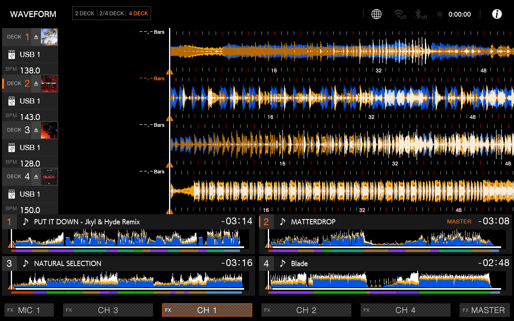
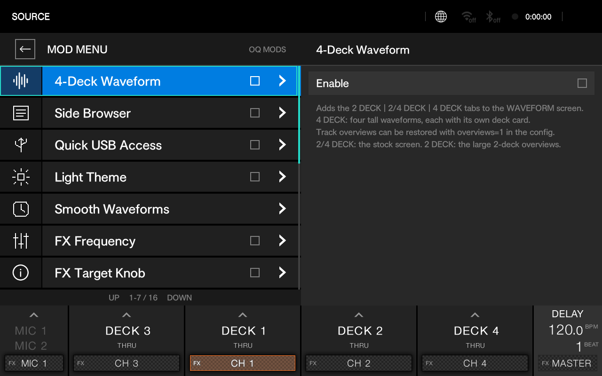
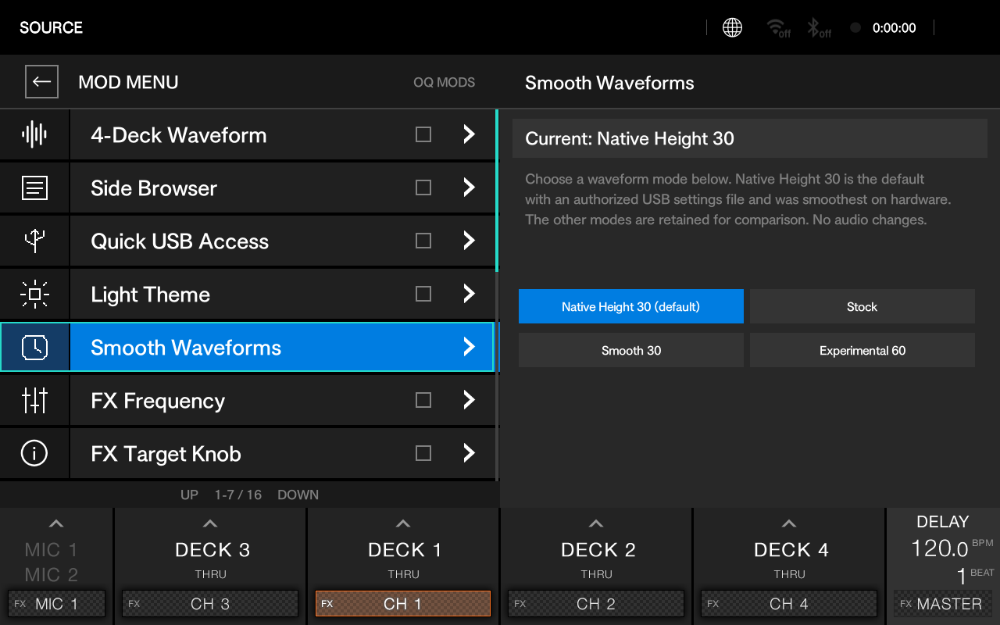
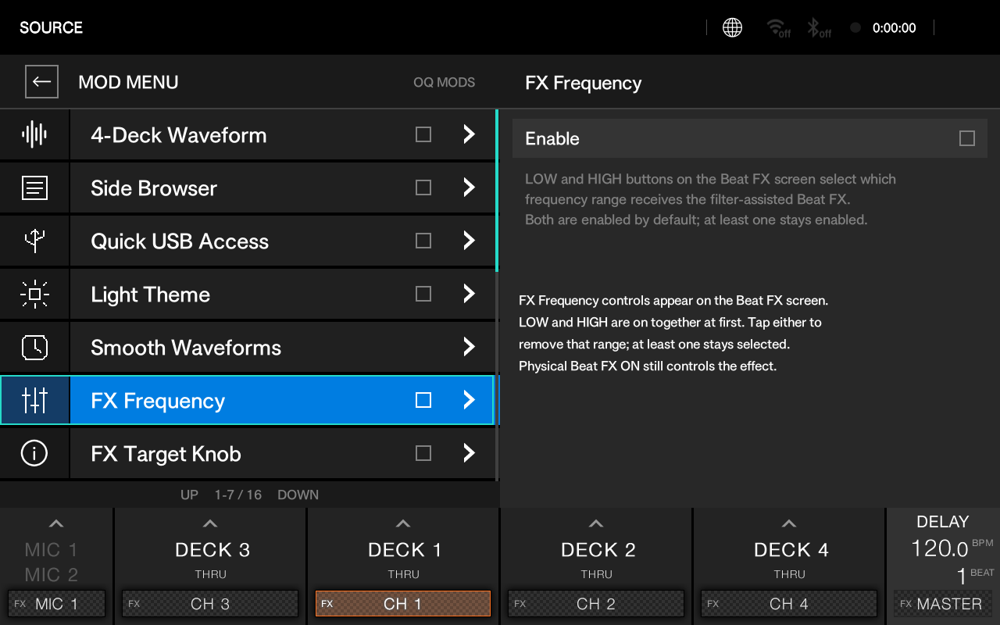
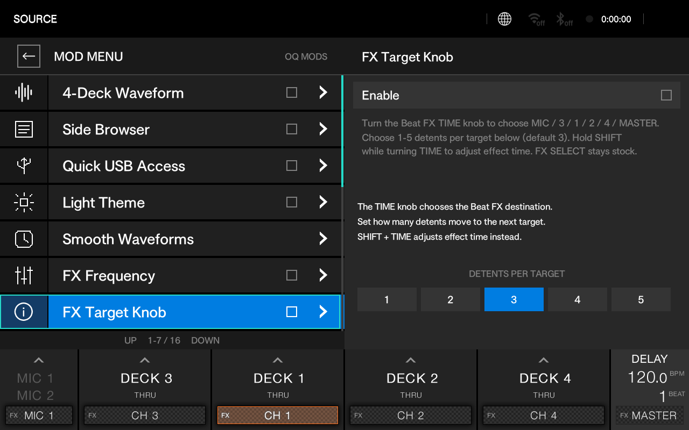
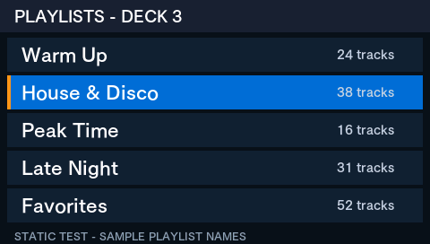
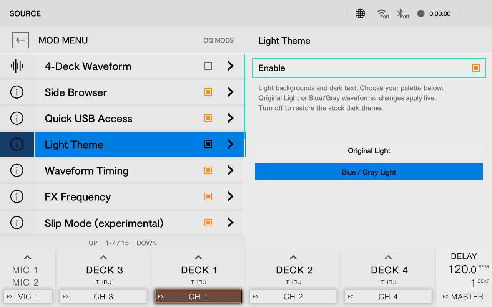
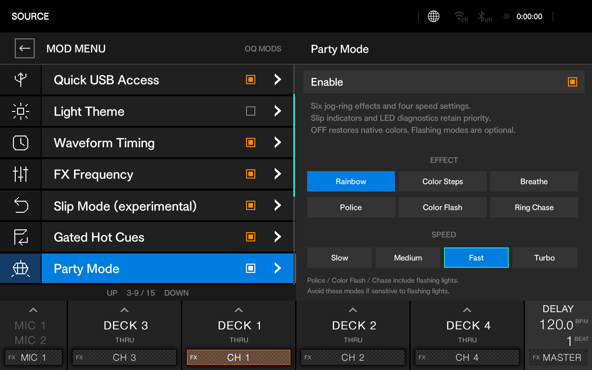
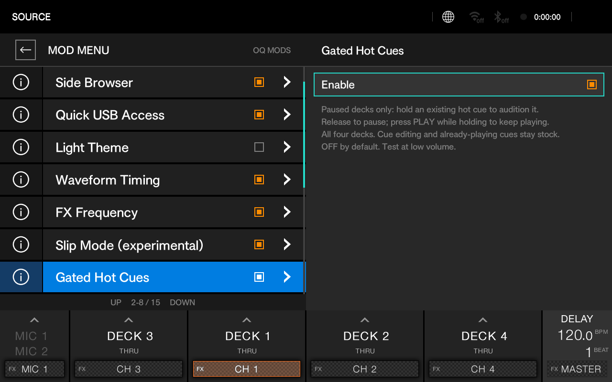

# OPUS-QUAD 1.32X — OQ MODS

  <strong>An experimental custom-firmware project for the Pioneer DJ OPUS-QUAD</strong> 
  Four-deck waveform layout · side-screen browsing · performance and mixer extensions

  
  
  

> **Experimental firmware — read before installing.** This project modifies firmware for dedicated DJ hardware. A previous experimental build has been installed and tested on one OPUS-QUAD, and stock MAIN firmware was restored successfully on that unit. The current **R53 candidate has not yet been installed or boot-tested on hardware**. The screenshots below are labeled by their actual evidence source; most are QEMU previews, not photos of the player. Keep a known-good stock update available and do not treat any recovery path as guaranteed.

This repository is being prepared for a **binary-only release**. Source code is intentionally not included in this draft. The README is a working release document and should be updated with the exact downloadable artifact, checksum, and hardware test results before binaries are published.

---

## At a glance

OQ MODS adds an optional mod menu and a set of selectable changes to the OPUS-QUAD's native interface. The central feature is a four-lane detailed-waveform view, arranged to keep the two main mixer decks together:

**Deck 3 → Deck 1 → Deck 2 → Deck 4**

Other additions include side-screen track browsing, quick USB shortcuts, alternate waveform timing, a light theme, FX frequency controls, per-deck Slip behavior, gated hot cues, jog-ring effects, and diagnostics. Some entries are observation/research tools only and do not alter audio or playlist data.

### Feature list and roadmap

The checklist below describes project functionality—not a guarantee that every feature has been re-tested in the latest firmware candidate. The current R53 candidate still needs its own hardware validation; see the [release checklist](RELEASE-CHECKLIST.md).

#### Implemented

- [x] **Four-deck waveform layout** — four native detailed waveform lanes, ordered Deck 3 → Deck 1 → Deck 2 → Deck 4.
- [x] **Light theme** — optional light palettes, including the blue/gray waveform palette.
- [x] **Side-screen track browsing** — browse USBs, playlists, and tracks from the player’s side displays.
- [x] **Slip mode** — per-deck Slip behavior mapped to the SLIP REVERSE control.
- [x] **FX frequency isolation** — LOW/HIGH controls for applying Beat FX to the selected frequency range.
- [x] **FX target selection with the TIME knob** — select the FX target without using the touchscreen; SHIFT retains TIME adjustment.
- [x] **Gated hot cues** — hold-to-audition behavior with cue-point return and PLAY latch behavior.
- [x] **Quick USB switching** — on-screen shortcuts to detected USB sources.
- [x] **Jog-ring Party Mode** — selectable LED patterns and speeds.
- [x] **USB-persisted mod settings** — save mod choices on USB and restore them on a later boot when the settings file is present.

#### Roadmap

- [ ] **Playlist editing** — create or modify playlists from the player.
- [ ] **Stems support** — investigate native stem playback and controls.
- [ ] **Large moving waveforms on side screens** — show full-size, live deck waveforms on the side displays.
- [ ] **Additional small-font options** — fit more information into the main display’s browse views.
- [ ] **Double/halve BPM** — add quick BPM doubling and halving controls.
- [ ] **Bluetooth-in waveform recording** — explore recording an incoming Bluetooth source, similar to the XDJ-AZ feature.
- [ ] **Full PRO DJ LINK support** — investigate networked player and library integration.

---

## Screenshots

These images are useful for understanding the UI, but they are **not all from the same build**. The caption identifies the evidence source and revision. QEMU/offline previews demonstrate layout and drawing only; they do not prove physical controls, playback, or LCD performance.

### Four detailed waveform lanes

*QEMU preview from the R20 layout work: four detailed waveform lanes, a Beat FX box on the right, and no four mini-player/overview cards along the bottom. It is newer than the previous README image, but still predates R53 and is not a hardware capture or performance guarantee.*

### OQ MODS menu and waveform timing

*R53 QEMU capture. The left list keeps feature mods above diagnostics and maintenance items.*

*R53 QEMU capture. Native Height 30 is selected by default when the USB settings file is authorized; all four timing choices are shown together.*

### FX controls

*R53 QEMU menu capture; the image shows the setting description, not a hardware audio measurement.*

*R53 QEMU capture. TIME sensitivity choices range from one to five detents per target, with three selected.*

### Side browser and visual options

*Offline UI preview with sample playlist names. Earlier hardware tests confirmed side-screen browsing and loading; this particular image is a static offline preview and contains fixture text.*

*Earlier QEMU capture of the optional Blue / Gray Light palette.*

*Earlier QEMU capture of the jog-ring effect and speed selectors. Flashing effects are optional.*

### Other mod previews

*Earlier QEMU settings preview. Gated cue behavior was subsequently reported working on hardware in an earlier build.*

*Earlier QEMU settings preview. Per-deck Slip behavior through SLIP REVERSE was subsequently reported working on hardware in an earlier build.*

---

## Included mods and tools

The list below describes the R53 candidate. **“Previously hardware-tested” refers to an earlier revision**; it does not mean that R53 itself has passed a physical install/test. R53 changes the authorization and persistence path, so treat every entry as needing a post-install smoke test.

### 1. 4-Deck Waveform

Adds deck-count tabs to the WAVEFORM screen. The four-deck view uses four native detailed waveform lanes, each tied to a deck, with the lane order **3 / 1 / 2 / 4**. A two-deck/stock view and a two-deck overview view remain available. Compact overview rows can be configured separately.

**Use:** Open the native WAVEFORM screen and select the desired deck layout. R53's new default timing mode is Native Height 30 when a valid settings file is present.

**Evidence:** Four-lane waveform layout and real library tracks were previously demonstrated on the physical OPUS-QUAD. R53's update/boot is not yet hardware-verified.

### 2. Side Browser

Opens a browser on the corresponding side display when a deck selector is held for about one second. The left display handles Deck 1/3; the right handles Deck 2/4. It follows the hierarchy **USB → Playlists → Tracks**, and can use the native playlist/session position when available.

Default navigation uses the paired **Track Search** buttons (Prior Track / Next Track) to move through a list. Deck selector buttons move backward/forward through browser levels and confirm the load flow. A paused deck requires confirmation before loading; the stock LOAD LOCK should remain enabled. A playing deck is protected from an unsafe load. If the active USB changes during selection, the browser asks you to select the track again.

**Previously hardware-tested:** Browsing and loading through side screens were reported working. The image above is a static offline sample, not a live hardware capture.

### 3. Quick USB Access

Places named shortcuts for detected USB sources near the waveform header. Selecting one opens the **native** browser at that source; it does not directly load a track. Disconnected devices are rejected rather than silently redirected.

### 4. Light Theme

Switches from the stock dark interface to a light palette. The palette selector offers **Original Light** and **Blue / Gray Light**; disabling the mod restores the stock dark theme. Palette controls update live.

### 5. Smooth Waveforms

Selects among four waveform rendering/timing modes:

| Mode | Purpose |
|---|---|
| **Native Height 30** | R53 default. Avoids the per-frame waveform scaling used by other modes; some layouts may crop a small amount vertically. |
| **Stock** | Original timing/rendering path for comparison. |
| **Smooth 30** | Alternate 30 Hz-oriented update mode. |
| **Experimental 60** | Higher update target; may not improve overall frame rate when several detailed lanes are active. |

All choices are visible as buttons in R53 rather than hidden behind a cycling control. The owner measured roughly 30 fps with Native Height 30 on an earlier physical build. Actual frame rate depends on active decks, tracks, and firmware state; the FPS overlay reports native repaint rate, not LCD scanout.

### 6. FX Frequency

Adds **LOW** and **HIGH** controls to the Beat FX interface. Both ranges are enabled initially; at least one remains enabled. The control selects the range receiving the filter-assisted Beat FX behavior. The physical Beat FX ON control still determines whether the effect is engaged.

The owner reported hearing the effect isolated toward the selected low/high range in an earlier build. R53's current behavior has not been re-tested on hardware. It should not be described as a replacement for the hardware's three-band EQ isolation until verified on the target unit.

### 7. FX Target Knob

Repurposes the Beat FX **TIME** knob to move the FX target through this order:

**MIC → Deck 3 → Deck 1 → Deck 2 → Deck 4 → MASTER**

The sequence wraps in either direction. A separate setting selects **1–5 detents per target**; the default is **3**. Hold **SHIFT** while turning TIME to adjust the effect time. The separate **FX SELECT** knob remains stock. R53 separates this from FX Frequency and makes the sensitivity configurable.

### 8. Slip Mode

When enabled, each deck's physical **SLIP REVERSE** button toggles Slip for that deck without reversing playback. When disabled, the button returns to its stock Slip Reverse function. The owner reported per-deck behavior working on hardware in an earlier build. LED feedback is intended to follow the active Slip state; verify this after installing R53.

### 9. Gated Hot Cues

Allows an existing hot cue to be held as a gated audition on a paused deck. Releasing the cue returns to that cue point. Pressing PLAY while holding the cue latches playback so it continues after release. Cue editing and hot-cue behavior on already-playing decks remain stock. The owner reported the core behavior working on a prior hardware build; retest R53 before relying on it in performance.

### 10. Party Mode

Optional jog-ring effects include **Rainbow, Color Steps, Breathe, Police, Color Flash,** and **Ring Chase**, with **Slow, Medium, Fast,** and **Turbo** speed choices. Native Slip/browser indicators and LED diagnostics take priority; disabling Party Mode restores native LED colors.

> **Photosensitivity warning:** Police, Color Flash, and Ring Chase use flashing lights. Avoid those effects if you or anyone nearby is sensitive to flashing light. This warning is not a medical safety guarantee.

### 11. FPS Overlay

Displays the measured waveform repaint rate in the waveform view. It counts native repaint passes; it is **not** a direct measurement of LCD panel refresh or end-to-end animation smoothness.

### 12. Stems — research/observation only

Provides a read-only foundation for investigating an AZ-style stems port. It does **not** separate audio, mute stems, replace deck audio, or make a track's stem files playable. Stem files must be prepared externally, and matching/deck identity remains a separate engineering problem.

### 13. Playlist Editing — research/observation only

This is not a playlist editor yet. It does not create, rename, reorder, or delete playlists and it does not write to the USB library database. The native writer/thread interface has not been verified for OPUS-QUAD. Use the normal export workflow for actual library changes.

### 14. System Info and Runtime Diagnostics

System Info shows build/revision details and can write a diagnostic report to USB. Reports are intended to help troubleshoot firmware updates and runtime behavior. A diagnostic authorization marker and the OQ MODS settings file serve different purposes; see [USB files and settings](#usb-files-and-settings).

### 15. LED Diagnostics

Provides bounded LED test pulses for identifying mapped controller indicators. Tests are temporary and intended for diagnosis; unmapped controls may not illuminate. Stop/timeout restores normal output. Do not assume an E/C test identifier represents a specific LED unless it has been physically mapped.

---

## USB files and settings

R53 uses a settings file on a mounted USB stick as the **authorization and persistence location** for the mod menu:

| File | Role |
|---|---|
| `OPUSQUADv132.UPD` | Firmware update package. Keep the filename unchanged. |
| `OPUS_DIAGNOSTICS_ENABLE.txt` | Enables the protected updater/diagnostic report path. It is not the OQ MODS menu switch. |
| `OPUSMOD_SETTINGS.cfg` | Authorizes the OQ MODS menu row and stores mod choices. |

Copy all three files from the release's `01-INSTALL-USB` folder to the **root** of the update USB. Do not rename the UPD. The supplied R53 settings template defaults feature mods to off, selects Native Height 30, and sets FX Target Knob sensitivity to 3.

The settings file must be writable if you want menu changes to persist. R53 scans mounted USB volumes in its configured device order; when more than one authorized settings file is present, the first matching mounted volume supplies settings. This is not necessarily the currently highlighted source in the normal player browser.

The updater package deliberately retains the stock-compatible filename and displayed release number **1.32**. The custom identifier **1.32X R53** is shown in OQ MODS System Info; renaming the UPD to `OPUSQUADv132X.UPD` is not supported.

With no valid `OPUSMOD_SETTINGS.cfg` on a mounted USB, the OQ MODS source/menu row is hidden and mod features are disabled. **This is a stock-looking mode, not the original stock firmware**: the custom module is still part of the firmware image. Removing the settings file does not uninstall the firmware. Previous R52 internal settings are ignored by R53 but not deleted; rolling back to R52 may make those old settings active again.

---

## Installation overview

> **Do not install the R53 candidate until its hardware release checklist is complete.** These instructions are for documenting the intended process, not a claim that the current candidate is safe or validated.

1. Confirm the exact package is for the OPUS-QUAD and the intended stock base. The R53 candidate is based on **stock firmware 1.32**; do not use it on another model or assume compatibility with another firmware revision.
2. Keep a verified stock update package available on a separate USB. Stock MAIN restore succeeded on the project owner's unit previously, but full DECK/MIXER rollback has not been proven.
3. Prepare a USB stick with enough free space and copy the release files to its root. Eject it cleanly.
4. Enter the player's firmware update mode using the established OPUS-QUAD procedure. On the owner's unit, this was **holding right-deck BEAT SYNC and MASTER while powering on**. Confirm the update screen identifies the intended package before proceeding.
5. Maintain stable power and do not remove the stick or interrupt the update. If the updater reports failure or corruption, stop and preserve the diagnostic/trace reports rather than repeatedly retrying an unchanged package.
6. After a successful update and boot, verify the OQ MODS build identifier in System Info, confirm the settings file is detected, then test one feature at a time at low volume.

Consult the release-specific `README-FIRST.md` and recovery notes that accompany any future published binary. If those disagree with this overview, follow the package-specific document and stop if the target/version is unclear.

---

## Known limitations and not-yet-included work

- **R53 has not been physically installed or boot-tested.** QEMU cannot validate hardware update acceptance, controller behavior, button timing, audio, or display performance.
- USB settings read/write persistence was exercised against a RAM-backed QEMU test USB; real-stick persistence on hardware is still to be verified.
- Full stock rollback of all firmware components is not proven. A successful stock MAIN restore is not equivalent to confirming DECK and MIXER recovery.
- The smaller-than-stock Browse font option is omitted: the stock firmware rejects a fourth font preset.
- Stems are observation-only; audio separation/replacement is not implemented.
- Playlist editing is observation-only; library database writes are not implemented.
- FX frequency behavior, jog LEDs, and frame rate should be rechecked on R53 hardware.

---

## Safety, compatibility, and project status

- **Target:** Pioneer DJ OPUS-QUAD, stock 1.32 base for R53.
- **Not a Pioneer product:** OQ MODS is an independent community modification and is not affiliated with or endorsed by AlphaTheta/Pioneer DJ.
- **No warranty:** Installing modified firmware may cause loss of functionality or require recovery. You are responsible for verifying the target package and maintaining a recovery path.
- Do not flash an image intended for the XDJ-AZ or another device. Shared architecture does not mean firmware packages are interchangeable.
- The binary release should publish a SHA-256 checksum and exact validation status. No key material, user music, or Rekordbox database belongs in a public release.
- Firmware redistribution may be subject to the device manufacturer's licensing and copyright terms. Obtain the required authorization before publishing firmware binaries; consider publishing only the mod module/patch artifacts if redistribution of the base firmware is not permitted.

## Credits

Thanks to **Kyle Hosman**, creator of [XDJ-AZ Mods](https://github.com/Kyle-Hosman/xdj-az-mods), and to **LycheeAPPF** and **Tratosca** for their guidance, research, and community support. Their work and advice helped inform this independent OPUS-QUAD project; this does not imply that AZ firmware or binaries are compatible with the OPUS-QUAD.

---

Draft documentation for a binary-only release. Last updated for the R53 candidate; replace candidate status, screenshots, checksums, and install notes with the final release evidence before publishing.
