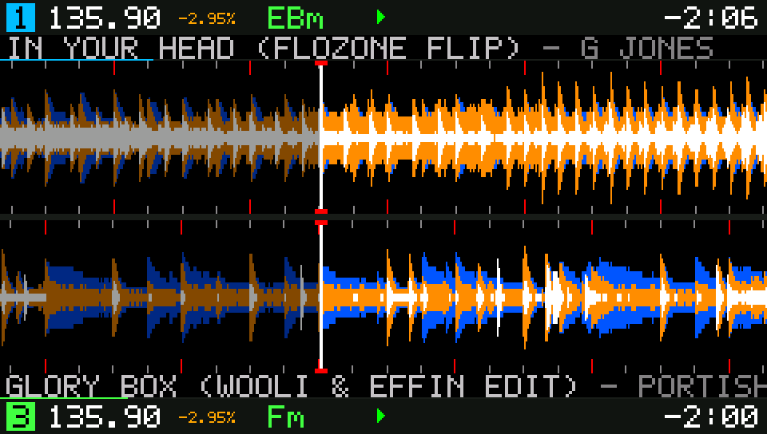
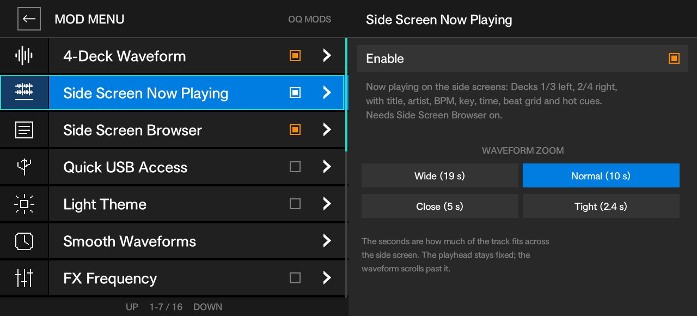
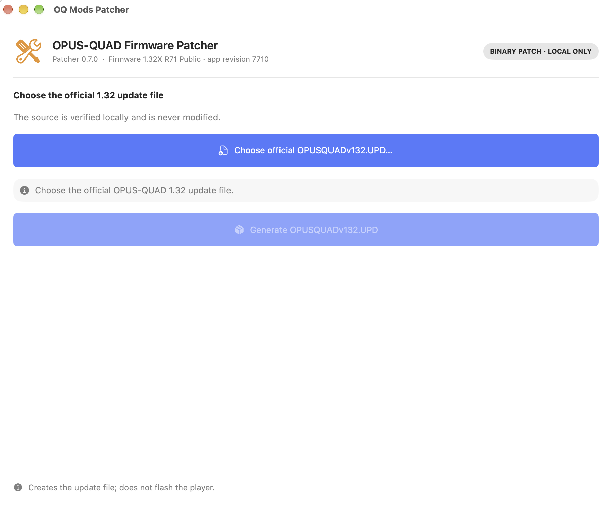

# Robs Opus Quad Mods

**The first custom firmware for the Pioneer OPUS-QUAD.**

Robs Opus Quad Mods is a custom-firmware project for the OPUS-QUAD, based on official firmware **1.32**.

The current public build is **R94 (1.32X)**. It adds a native four-deck waveform layout, FLX10-style "now playing" side screens, a side-screen browser, stems, and a collection of optional interface, browsing, FX, cue and jog-ring features. The public release is distributed as a binary patcher; Pioneer firmware files are not included.

> **Use this firmware at your own risk.** I have flashed firmware on my OPUS-QUAD many times—well over a hundred—and have always been able to recover from failed attempts by restoring stock firmware. That is my experience, not a guarantee: a failed flash could still leave your unit unusable, and recovery may not work for everyone. Keep a known-good official stock 1.32 update available on a separate USB, use reliable power, and never interrupt an update. Use only with an OPUS-QUAD and the exact official 1.32 update file accepted by the patcher. I have tested restoring stock 1.32 and installing a custom build on a physical unit; this does not guarantee every unit or future build.

### Four-deck waveform view

Four native detailed waveforms in **Deck 3, Deck 1, Deck 2, Deck 4** order (the mixer order), or **1, 2, 3, 4** if you prefer. The optional Beat FX sidebar sits at the right; the original track overviews can be enabled separately.

### Side screen now playing

The side displays become FLX10-style deck views: Decks 1/3 on the left, 2/4 on the right. Each deck shows a scrolling waveform with its beat grid, hot cues, memory cues and loops in their rekordbox colors, plus BPM, pitch, key, remaining time, and the track title and artist. Four zoom levels, from Wide (19 s) to Tight (2.4 s).

### Browse from the side screens

Hold a deck selector to open that deck's side-screen browser. Browse USB → playlist → track, then confirm to load. Track lists show the title, artist, BPM and key. Navigate with the beat-loop wheels (default), the deck buttons or the track-search buttons.

### Stems (Experimental)

Mute VOCAL, INST, BASS and DRUMS per deck in real time from the touch screen. Make the stems on a computer (Demucs or the AZ-MODS app) and put them on the USB as `STEMS/<track file name>/vocals.ogg other.ogg bass.ogg drums.ogg`. Tap **STEMS** at the top of the WAVEFORM screen to open the buttons: a strip under the waveforms in 2 DECK, and above the channel select row in 4 DECK. Tempo, key and scratching still apply. The first load of a track takes a few seconds while its stems are decoded.

### Light Mode

An alternate, softer interface palette that keeps the four-deck layout and the right-side FX panel.

### Gated Hot Cues

Hold a hot cue to audition it; releasing returns to the cue point and stops playback unless PLAY was pressed while the cue was held. A quick toggle is available in the Beat FX sidebar.

### FX Frequency

**LOW | ALL | HIGH** in the Beat FX box: LOW keeps the effect in the lows, HIGH in the highs, ALL is the stock full range. The choice stays when you switch effects; tap the lit LOW or HIGH again to go back to ALL.

### Slip Mode

Slip Mode is toggled per deck through the SLIP REVERSE control, with LED feedback. When the mod is disabled, the control returns to its stock Slip Reverse behavior.

### Quick USB Access

Named, color-aware USB shortcuts near the waveform header; the active USB is highlighted. Selecting one opens that USB's native browser rather than loading a track directly.

### Zone Continuous Play

With ZONE output on and assigned to channel 3 or 4, that deck loads and plays the next track of its playlist when a track ends, whatever the global Continue/Single setting. Other decks are unchanged.

### Party Mode

Optional jog-ring effects—Rainbow, Color Steps, Breathe, Police, Color Flash and Ring Chase—with four speed settings. Slip indicators keep priority, and turning Party Mode off restores native colors. Flashing effects are optional; avoid them if you or anyone nearby is sensitive to flashing lights.

## Included mods

Enable or configure these from the on-device **OQ Mods** menu (SOURCE > MOD MENU). Most are off by default.

- **4-Deck Waveform** — four full-height native waveform lanes, in mixer order (3 / 1 / 2 / 4) or deck order (1 / 2 / 3 / 4). The stock 2 DECK and 2/4 DECK layouts remain available.
- **Side Screen Now Playing** — FLX10-style deck views on the side displays: waveform, beat grid, hot cues, memory cues and loops, BPM, pitch, key, remaining time, title and artist. Four zoom levels. Needs Side Screen Browser on.
- **Side Screen Browser** — a deck-specific browser on the side displays. Browse USBs, playlists and tracks (with artist, BPM and key) and confirm to load. Beat-loop wheels by default, with deck-button and track-search-button schemes available. Stock Load Lock is required.
- **Quick USB Access** — named, color-aware on-screen USB shortcuts that open the selected source in its native browser; the active one is highlighted.
- **Light Theme** — alternate light palettes, including a blue-waveform option.
- **Smooth Waveforms** — Native Height 30 (default and recommended), Stock, Smooth 30 and 60 FPS.
- **FX Frequency** — LOW | ALL | HIGH for Beat FX, kept across effect changes.
- **Beat FX Sidebar** — the Beat FX panel at the right of the main waveform screen in every deck tab. It steps aside for the INPUT, crossfader, MIC and track-info pop-ups.
- **FX Target Knob** — turn the Beat FX TIME knob to step through MIC, Deck 3, Deck 1, Deck 2, Deck 4 and MASTER, with one to five detents per target (three by default). Hold SHIFT while turning TIME for normal effect-time adjustment.
- **Slip Mode** — the Slip Reverse control toggles Slip per deck, with LED feedback.
- **Gated Hot Cues** — hold a hot cue for gated playback; release returns to the cue point unless PLAY was pressed while holding. Quick toggle in the FX sidebar.
- **Party Mode** — jog-ring effects and speed settings described above.
- **Hide Track Names** — an eye on each track box in the 2 DECK tab hides that deck's title and artist on the main screen and on the side screens. Tap it again to show them.
- **Zone Continuous Play** — the zone deck (channel 3 or 4) plays on through its playlist.
- **Stems (Experimental)** — real-time VOCAL / INST / BASS / DRUMS mutes per deck from pre-made stem files. Based on the AZ-MODS stems engine.
- **Playlist Editing (Experimental)** — reorder the tracks of a USB playlist in main Browse: hold the browse knob on a track, turn to move it, press to drop, then BACK to save. This writes the USB library; the first save each boot backs up `exportLibrary.db` and `export.pdb` to `OPUSMOD_BACKUP` on that USB. Use it with a USB you have a copy of.
- **Persistent settings** — mod settings are stored in `OPUSMOD_SETTINGS.cfg` on the USB. The patcher preserves an existing settings file and creates a default one only if it is missing.

## Getting started

### Firmware patcher

The macOS and Windows patchers verify the official 1.32 source locally and generate the R94 update file; they do not flash the player.

1. Obtain the official OPUS-QUAD **1.32** update from Pioneer DJ. It is not bundled here.
2. Download the matching Opus Quad Mods patcher for macOS or Windows from the project's **Releases** page.
3. Open the patcher, choose the official `OPUSQUADv132.UPD`, and generate the modified update. The patcher validates the input and verifies the output locally; it does not upload firmware or flash the player.
4. Copy the generated `OPUSQUADv132.UPD` to the root of a dedicated update USB. Keep the stock 1.32 update on a separate, clearly labeled recovery USB.
5. With the unit powered off, hold **BEAT SYNC** and **MASTER** on the right deck while powering it on to enter the update screen. Follow the on-screen instructions. Do not power off or remove the USB during the update. R94 also updates the side-screen controller, so the update takes about a minute longer than a stock update.
6. After reboot, open the on-device OQ Mods menu and enable the features you want. Keep `OPUSMOD_SETTINGS.cfg` on the USB whose settings you want to use. **Settings > General > Version No.** shows **1.32X R94**.

The standalone patchers are versioned independently from the firmware. Confirm the patcher version and R94 build details in the matching release notes before generating an update.

## Roadmap

- One-touch beat-grid ×2 / ÷2
- Cover art in the side-screen browser
- Live Bluetooth deck with a recorded waveform (OMNIS-DUO style)
- Full PRO DJ LINK support
- Smaller system-wide font options

## Credits

- **Kyle Hosman** — creator of the XDJ-AZ Mods project, whose public work provided valuable reference and inspiration. The stems engine is a port of the AZ-MODS stems engine (GPL-3.0); its source is published with each release that includes it.
- **LycheeAPPF, Tratosca and Sam Leone** — guidance and knowledge shared during development.
- The OPUS-QUAD community and everyone who tested builds and reported results.

Opus Quad Mods is an independent community project and is not affiliated with or endorsed by AlphaTheta or Pioneer DJ. Product names are used only to identify compatibility.
