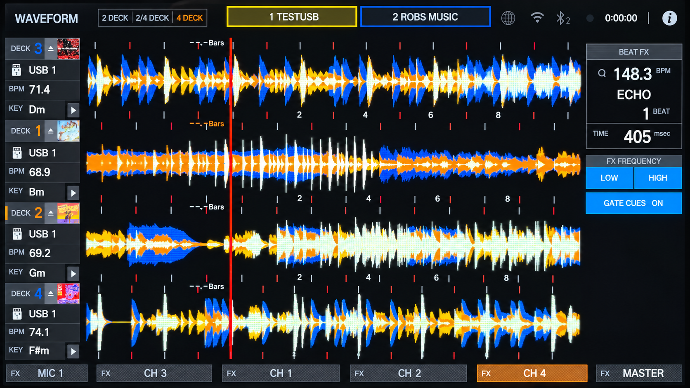
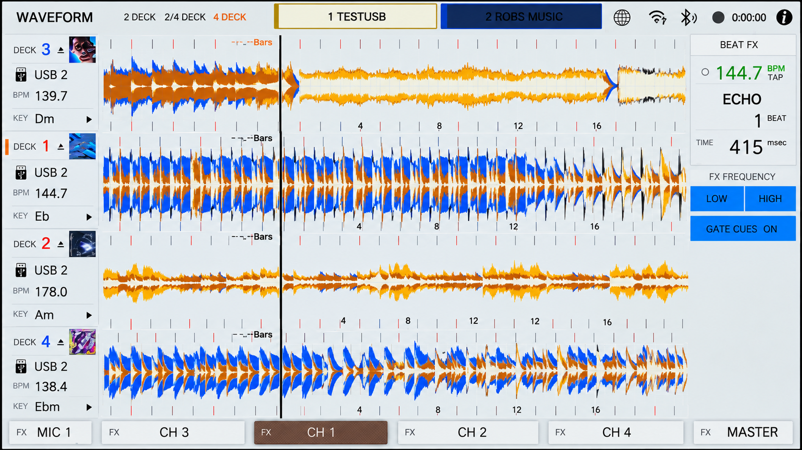
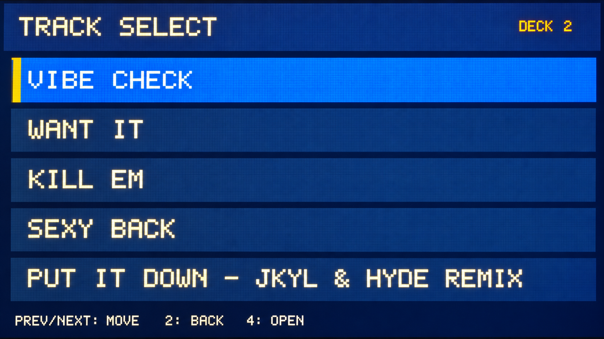
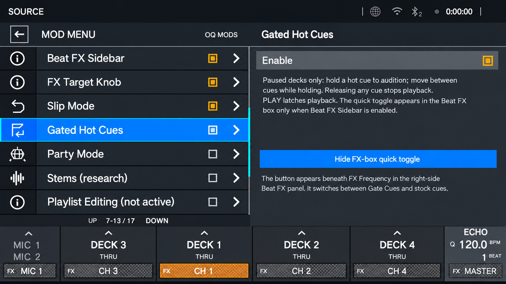
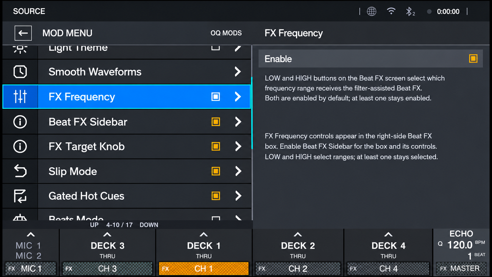
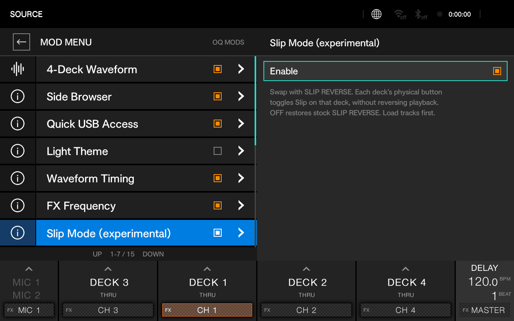
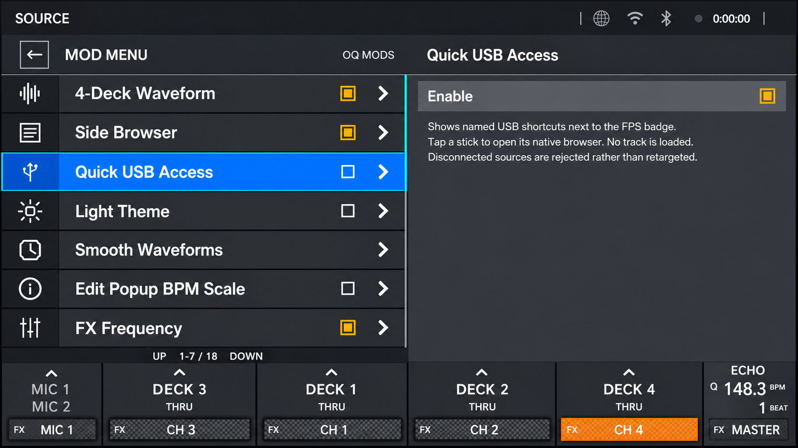
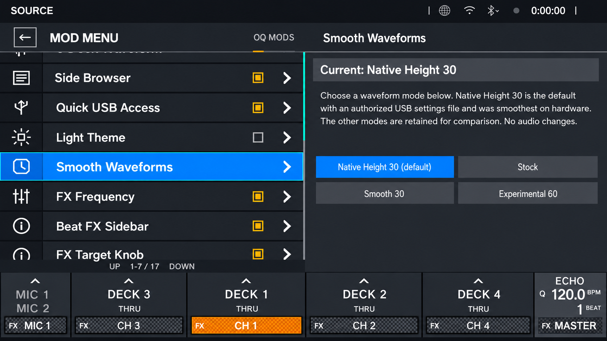
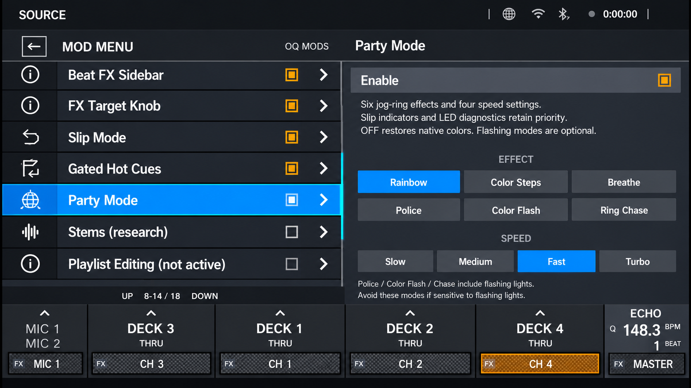
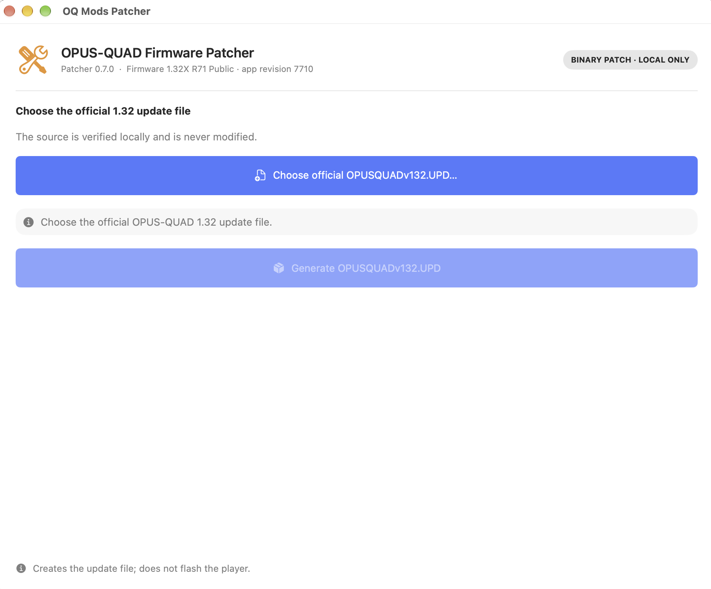

# Robs Opus Quad Mods

**The first custom firmware for the Pioneer OPUS-QUAD.**

Robs Opus Quad Mods is a custom-firmware project for the OPUS-QUAD, based on official firmware **1.32**.

The current public build is **R71 (1.32X)**. It adds a native four-deck waveform layout and a collection of optional interface, browsing, FX, cue, and jog-ring features. The public release is distributed as a binary patcher; Pioneer firmware files are not included.

> **Use this firmware at your own risk.** I have flashed firmware on my OPUS-QUAD many times—well over a hundred—and have always been able to recover from failed attempts by restoring stock firmware. That is my experience, not a guarantee: a failed flash could still leave your unit unusable, and recovery may not work for everyone. Keep a known-good official stock 1.32 update available on a separate USB, use reliable power, and never interrupt an update. Use only with an OPUS-QUAD and the exact official 1.32 update file accepted by the patcher. I have tested restoring stock 1.32 and installing a custom build on a physical unit; this does not guarantee every unit or future build.

## Feature gallery

The following are perspective-corrected, cleaned-up visual renderings based on owner-supplied photos of the physical unit, except where a caption identifies a QEMU preview. They are illustrative and not raw framebuffer captures; fine visual details may be smoothed during cleanup.

### Four-deck waveform view

Four native detailed waveforms are arranged **Deck 3, Deck 1, Deck 2, Deck 4**, keeping the primary Deck 1/2 lanes centered. The optional FX sidebar sits at the right; the original track overviews can be enabled separately.

### Light Mode

Light Mode provides an alternate, softer interface palette while retaining the four-deck waveform layout and right-side FX panel. The image below shows the light palette on the four-deck screen.

### Browse from the side screens

Hold a deck selector to open that deck's side-screen browser. Browse the USB → playlist → track hierarchy, select a track, and confirm loading. The browser supports the beat-loop wheels, deck buttons, or track-search buttons as the navigation scheme.

*Static UI preview of the side-browser track list; it uses sample content rather than a live library.*

### Gated Hot Cues

Hold a hot cue to audition it; releasing returns to the cue point and stops playback unless PLAY was pressed while the cue was held. A quick toggle is available in the Beat FX sidebar.

### FX Frequency

The LOW and HIGH controls isolate the frequency range that receives Beat FX. At least one range remains enabled.

### Slip Mode

Slip Mode is toggled per deck through the SLIP REVERSE control, with LED feedback. When the mod is disabled, the control returns to its stock Slip Reverse behavior.

### Quick USB Access

Quick USB Access adds named, color-aware shortcuts near the waveform header. Selecting one opens that USB's native browser rather than loading a track directly.

### Smooth Waveforms

The waveform timing options include **Native Height 30**, Stock, Smooth 30, and Experimental 60. For the four-deck layout, use **Native Height 30**: the other modes stutter on the OPUS-QUAD hardware.

### Party Mode

Party Mode adds optional jog-ring effects—Rainbow, Color Steps, Breathe, Police, Color Flash, and Ring Chase—with four speed settings. Slip indicators and LED diagnostics take priority, and turning Party Mode off restores native colors. Flashing effects are optional; avoid them if you or anyone nearby is sensitive to flashing lights.

## Included mods

Enable or configure these from the on-device **OQ Mods** menu. Some are disabled by default and are user-selectable.

- **4-Deck Waveform** — switches the WAVEFORM screen to four full-height native waveform lanes in Deck 3 / 1 / 2 / 4 order. The stock two-deck and 2/4-deck layouts remain available.
- **Smooth Waveforms** — includes Native Height 30, the recommended mode for four-deck use because the other modes stutter on hardware.
- **Light Theme** — alternate light palettes, including a blue-waveform option.
- **Side Browser** — opens a deck-specific browser on the left or right side display. Browse USBs, playlists, and tracks; confirm a selection to load it to that deck. The beat-loop-wheel scheme is the default, with alternative deck-button and track-search-button schemes available. Stock Load Lock is required.
- **Quick USB Access** — named, color-aware on-screen USB shortcuts that open the selected source in its native browser.
- **Beat FX Sidebar** — restores a compact FX panel at the right of the main waveform screen, including in layouts where the four-deck mode is off. It also provides space for the quick Gate Cue toggle and FX controls.
- **FX Frequency** — LOW/HIGH tone-isolation controls for Beat FX.
- **FX Target Knob** — use the Beat FX TIME knob to step through MIC, Deck 3, Deck 1, Deck 2, Deck 4, and MASTER. Sensitivity is adjustable from one to five detents per target; three is the default. Hold SHIFT while turning TIME to retain normal effect-time adjustment.
- **Slip Mode** — repurposes the Slip Reverse control to toggle Slip per deck, with LED feedback.
- **Gated Hot Cues** — hold a hot cue for gated playback; release behavior returns to the cue point unless PLAY was pressed while holding. A quick toggle is available in the FX sidebar when enabled.
- **Party Mode** — jog-ring effects and speed settings described above. Slip indicators and LED diagnostics take priority. Flashing effects are optional; avoid them if sensitive to flashing lights.
- **Persistent settings** — mod settings are stored in `OPUSMOD_SETTINGS.cfg` on the USB. The patcher preserves an existing settings file and creates a default one only if it is missing.

## Not included in the public build

Playlist editing, stem processing, and beat-grid editing are not presented as working R71 public features.

## Getting started

### Firmware patcher

The macOS patcher verifies the official 1.32 source locally and generates the R71 update file; it does not flash the player.

1. Obtain the official OPUS-QUAD **1.32** update from Pioneer DJ. It is not bundled here.
2. Download the matching Opus Quad Mods patcher for macOS or Windows from the project's **Releases** page.
3. Open the patcher, choose the official `OPUSQUADv132.UPD`, and generate the modified update. The patcher validates the input and verifies the output locally; it does not upload firmware or flash the player.
4. Copy the generated `OPUSQUADv132.UPD` to the root of a dedicated update USB. Keep the stock 1.32 update on a separate, clearly labeled recovery USB.
5. With the unit powered off, hold **BEAT SYNC** and **MASTER** on the right deck while powering it on to enter the update screen. Follow the on-screen instructions. Do not power off or remove the USB during the update.
6. After reboot, open the on-device OQ Mods menu and enable the features you want. Keep `OPUSMOD_SETTINGS.cfg` on the USB whose settings you want to use.

The standalone patchers are versioned independently from the firmware. Confirm the patcher version and R71 build details in the matching release notes before generating an update.

## Roadmap

- Real-time playlist editing and reordering
- Stem support
- Large moving waveforms on the side displays (FLX10 style)
- Smaller system-wide font options
- One-touch BPM half/double controls
- Bluetooth-in waveform recording
- Full PRO DJ LINK support

## Credits

- **Kyle Hosman** — creator of the XDJ-AZ Mods project, whose public work provided valuable reference and inspiration.
- **LycheeAPPF and Tratosca** — guidance and knowledge shared during development.
- The OPUS-QUAD community and everyone who tested builds and reported results.

Robs Opus Quad Mods is an independent community project and is not affiliated with or endorsed by AlphaTheta or Pioneer DJ. Product names are used only to identify compatibility.
